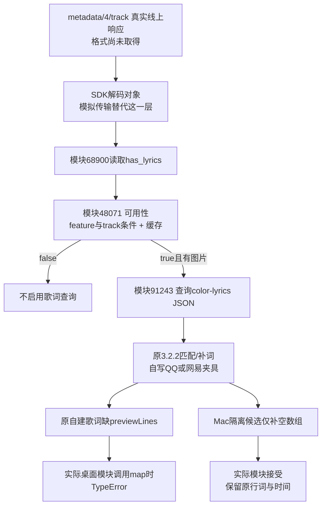

# 从桌面判断路径到候选修复

所有测试在Node VM中执行；没有运行真实Spotify UI，没有实时歌词来源调用。模块读取自已安装签名程序包的V8快照，核对快照哈希后在内存中抽取；不写出Spotify模块源码，不访问用户资料。

| 已确认事实 | 可复核文件 | 不能据此宣称 |
| --- | --- | --- |
| 模块83873的XE对应metadata/4；68900消费解码对象has_lyrics，未指定metadata format | desktop-modules.mjs；desktop-chain.test.mjs；evidence/desktop-contract.json | 线上一定是JSON、目标请求已经经过当前Entry |
| 48071配置staleTime600000ms；feature关闭或输入缓存false时，实际hook不启用后续查询 | 同上 | 当前真实缓存值、等待10分钟必然重查 |
| 91243在可用性true时才查询JSON歌词，还需要图片；其parser无条件调用previewLines.map | 同上 | 入口灰色故障由缺previewLines造成；原生播放/精确高亮已成功 |
| 固定3.2.2 Mac补词响应缺previewLines，QQ/网易夹具在实际parser中抛TypeError | fallback-fixture.mjs；desktop-chain.test.mjs | 手机原工作基线不可用、真实来源当前可访问或获授权 |
| Mac隔离候选补空数组后parser接受；404和严格空200两条路径均覆盖 | mac-fallback-compat.mjs；compat.test.mjs；desktop-chain.test.mjs | 已修好真实客户端；任意原200或权限结构都可改 |
| JSON元数据候选可使完整且身份匹配的自写JSON false变true，和补词候选组合后通过hook链 | candidate.test.mjs；desktop-chain.test.mjs | 目标真实gid编码/字段形状就是夹具格式 |
| C0仅输出固定类型摘要并原样放行，日志失败不影响完成；服务只提供精确校验文件 | observation.test.mjs；observer_server_test.py；MetadataObserveMac.lpx | C0已部署、Loon原生语法/日志视图已实测 |

共享有界JSON扫描器拒绝重复/转义重复键、深度/节点超限及畸形结构。候选通过原始token位置插入/替换，未知大整数、格式和字段原字节保留；原200有词、预览/权限提示、源失败、错误状态不扩大处理，原核心及手机产物保持。

`verify-desktop.mjs` 生成机器可读契约事实；`npm test` 的TAP及JSON汇总同时保存Node通过/失败/跳过与Python组结果。缺少已安装Spotify程序包的环境会明确跳过相关模块测试；不会记作原生成功。需要的最小真实取证见 [NATIVE-C0-PLAN.md](NATIVE-C0-PLAN.md)。
